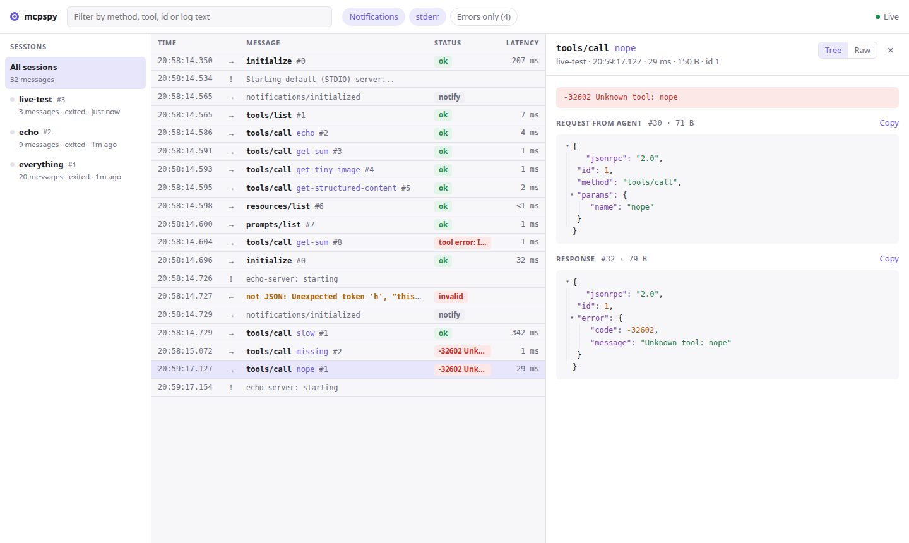
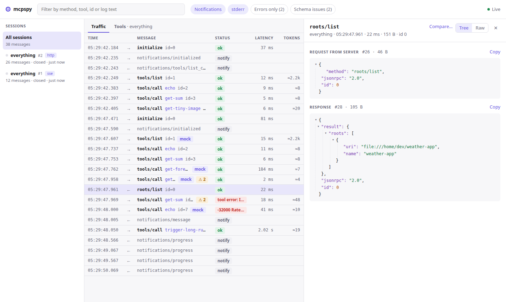
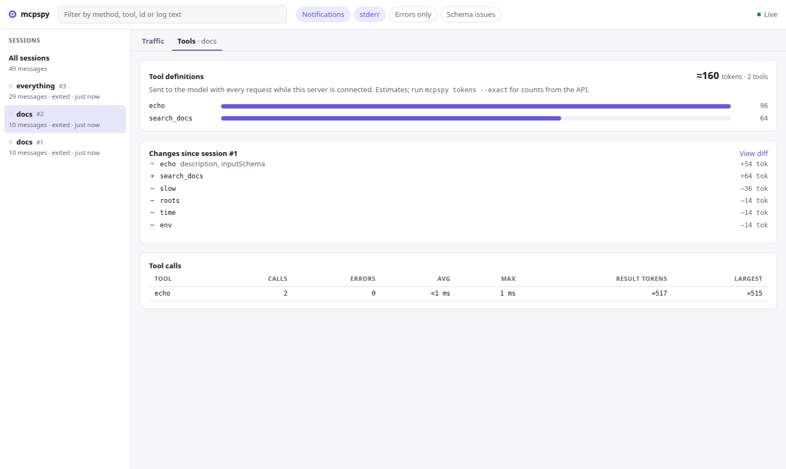
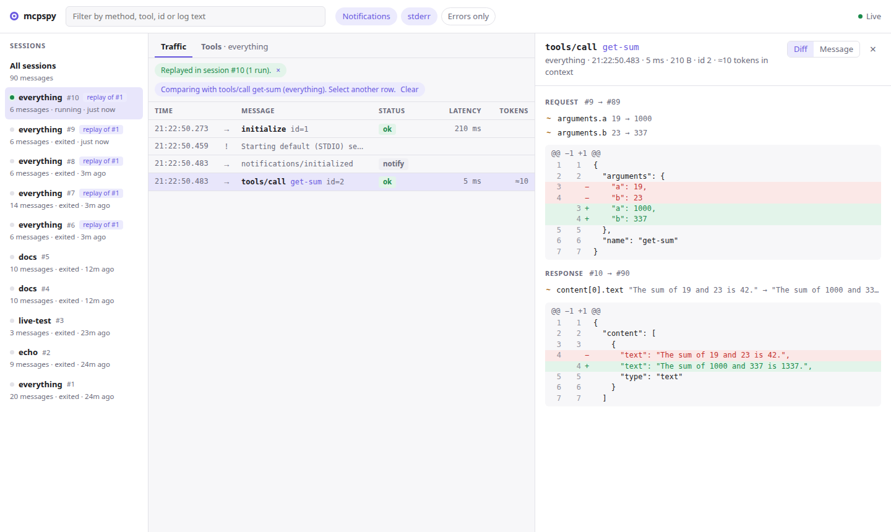
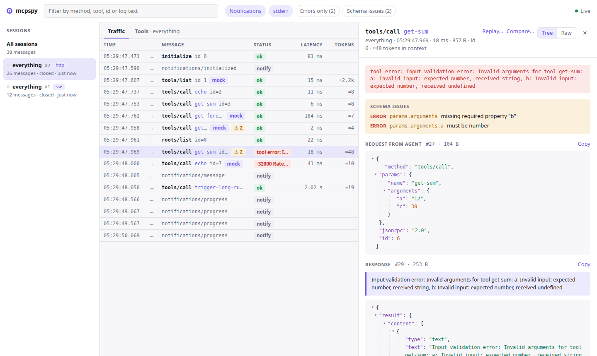
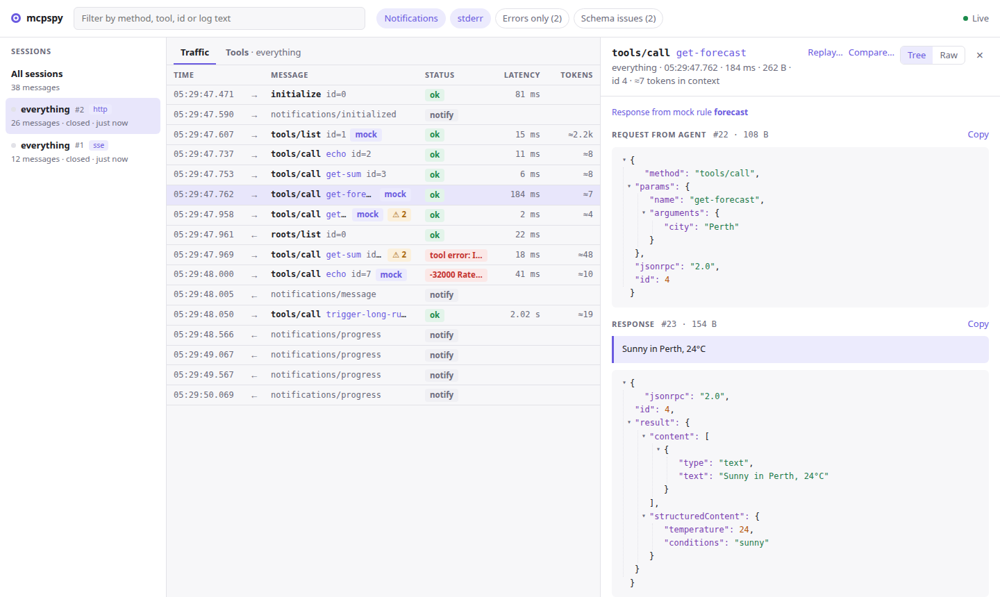

# mcpspy

An inspection proxy for [Model Context Protocol](https://modelcontextprotocol.io) servers. Put it between your AI agent (Claude Code, Cursor, Windsurf, …) and an MCP server to see every JSON-RPC message they exchange: which tools were called, with what arguments, how long they took, what failed, and how much they weighed.

Unlike the official MCP Inspector, which is a client *you* drive, mcpspy records what your real agent actually sends.



## Status

All six milestones are done.

- [x] stdio proxy, SQLite log, `tail` / `sessions` / `show`
- [x] Web UI: live stream, request/response pairs, JSON viewer
- [x] Token estimates per tool call and for `tools/list`, JSON diffing
- [x] Replay a recorded call against the server without the agent, and replay suites
- [x] Mock rules and schema validation (`inputSchema` / `outputSchema`)
- [x] Streamable HTTP and SSE proxying

## Install (from source)

Requires Node 22.13+ (uses the built-in `node:sqlite`).

```sh
npm install
npm run build
npm link        # puts `mcpspy` on your PATH
```

## Usage

Prefix the server command in your agent's MCP config with `mcpspy run --`. For example, in Claude Code's `.mcp.json`:

```json
{
  "mcpServers": {
    "github": {
      "command": "mcpspy",
      "args": ["run", "--name", "github", "--", "npx", "-y", "@modelcontextprotocol/server-github"]
    }
  }
}
```

Then open the inspector:

```sh
mcpspy ui --open      # http://localhost:7777
```

Every session shows up live. Each row pairs a request with its response, showing status, latency and size. Click a row to see both as a JSON tree or raw text, with tool results rendered the way the agent received them (text and images). Filter by server, text, notifications, stderr or errors only, and move between rows with ↑/↓.

### Servers over HTTP

For a remote server, or a local one that speaks Streamable HTTP or the older HTTP+SSE transport, start a proxy in front of it and point your agent at the local URL it prints:

```sh
mcpspy proxy https://mcp.example.com/mcp --name example
# mcpspy proxying https://mcp.example.com/mcp
# Point your agent at http://127.0.0.1:7800/mcp
```

```json
{
  "mcpServers": {
    "example": { "type": "http", "url": "http://127.0.0.1:7800/mcp" }
  }
}
```

Requests go to the same path on the real server, with their headers. Each MCP session (by `Mcp-Session-Id`, or by the legacy transport's event stream) is recorded as its own session. That includes JSON-RPC in POST bodies, JSON responses, and every event on SSE streams: progress notifications, and requests the server makes mid-call, such as `roots/list`. HTTP errors such as a 401 are logged with the session, and the session ends when the client sends DELETE or closes the stream. `--mocks` works here too.



Headers such as `Authorization` are forwarded but never recorded. So replays and suites against servers that need them take the headers on the command line: `mcpspy replay 42 -H "Authorization: Bearer $TOKEN"`.

### Context cost

Every tool definition a server advertises is sent to the model with every request, and every tool result lands in the conversation. mcpspy estimates both:

- The **Tokens** column shows what each result adds to the context.
- The **Tools** tab breaks a session's tool definitions down per tool. It also shows what changed in the tool list since that server's previous session (added, removed, or edited descriptions and schemas, with the token delta), plus per-tool call counts, errors, latency and result sizes.



```sh
mcpspy tokens                 # same report in the terminal, for the latest session
mcpspy tokens --exact         # exact counts from Anthropic's count_tokens API
```

Estimates are an offline heuristic (Claude's tokenizer isn't public), so treat them as relative sizes. `--exact` uses the [count_tokens](https://platform.claude.com/docs/en/build-with-claude/token-counting) endpoint (default model `claude-opus-5-5`, override with `--model`). It measures each tool by counting the request with and without it, and reports the fixed tool-use preamble separately. It needs `ANTHROPIC_API_KEY` or an `ant auth login` profile, and **sends the recorded tool definitions and results to Anthropic**. Results are cached in the log per model.

### Comparing calls

In the UI, click **Compare…** on one row, then select another. The detail pane shows the changed paths and a line diff of both requests and both responses. Lists of tools, prompts and resources are matched by `name` / `uri`, so an added or removed entry reads as exactly that. From the terminal:

```sh
mcpspy diff 12 40             # two requests: diffs their arguments and their responses
```

### Replay

Re-run any request the agent made, against a fresh copy of the server, without prompting the agent again. A replay:

- starts the server with the recorded command and working directory,
- sends the agent's own `initialize`,
- answers requests the server makes back (such as `roots/list`) with the agent's recorded replies,
- then sends the request, with the original params or your edits.

Each replay is recorded as a new session tagged *replay of #N*, so it can be inspected and diffed like any other traffic.

In the UI, select a request and click **Replay…** to edit its params and run it. The replayed call opens diffed against the original.



```sh
mcpspy replay 42                                # same params; diffs the response against the original
mcpspy replay 42 --args '{"query":"rust"}'      # new arguments for a tools/call
mcpspy replay 42 --repeat 20                    # latency spread over 20 runs in one server session
mcpspy replay 42 -e GITHUB_TOKEN=$GITHUB_TOKEN  # extra environment for the server
```

mcpspy records the *names* of the environment variables each server started with, never their values. If the original server had config-like variables (API keys, tokens, URLs) that aren't set when you replay, mcpspy names them so you can pass them with `-e` or start `mcpspy ui` with them exported.

### Replay suites

Save recorded calls to a JSON file in your server's repository, then check the server still answers the same way, without an agent:

```sh
mcpspy suite add mcp.suite.json 42 57 63   # cases from recorded requests
mcpspy suite run mcp.suite.json            # exits 1 if any response changed
mcpspy suite run mcp.suite.json --update   # accept the new responses
```

```
✓ tools/call echo 6ms
✗ tools/call search_docs 41ms
    content[0].text  "3 results" → "0 results"
✓ tools/call get-sum 1ms

2 passed, 1 failed
```

The suite stores each server's command and working directory (relative to the suite file when it's below it), or its URL for servers reached over HTTP. It also stores the `initialize` params and the agent's replies to server requests, plus each case's params and expected `result` or `error`. For values that change between runs, list their paths in a case's `ignore` array. `*` matches one key and `[*]` any array index, e.g. `["structuredContent.now", "content[*].text"]`. Run it in CI like any other test command.

Or stay in the terminal:

```sh
mcpspy tail -f
```

```
20:52:08.496 everything #1 → initialize id=0 150B
20:52:08.689 everything #2 stderr Starting default (STDIO) server...
20:52:08.716 everything #3 ← initialize ✓ 220ms id=0 3.4KB
20:52:08.729 everything #5 → tools/list id=1 46B
20:52:08.736 everything #6 ← tools/list ✓ 8ms id=1 9.9KB
20:52:08.761 everything #7 → tools/call echo id=2 108B
20:52:08.765 everything #8 ← tools/call echo ✓ 4ms id=2 89B
```

| Command | What it does |
| --- | --- |
| `mcpspy run [--name <label>] [--mocks <file>] -- <cmd> [args…]` | Start the server behind the proxy. `mcpspy -- <cmd>` is shorthand. |
| `mcpspy proxy <url> [--port 7800] [--name <label>] [--mocks <file>]` | Proxy a server reached over HTTP (Streamable HTTP or HTTP+SSE). |
| `mcpspy tail [-f] [-n 50] [--session <id>] [--json]` | Print recorded messages; `-f` follows new ones. `--json` emits NDJSON rows. |
| `mcpspy sessions [--limit 20]` | List recorded server sessions with exit status and message count. |
| `mcpspy show <message-id>` | Pretty-print a message alongside its request or response. |
| `mcpspy ui [--port 7777] [--open] [--read-only]` | Serve the web inspector on localhost. `--read-only` disables replay. |
| `mcpspy tokens [--session <id>] [--exact] [--model <id>]` | Context cost of a session's tools, call stats, and tool list changes. |
| `mcpspy diff <id> <id>` | Diff two messages, or two requests and their responses. |
| `mcpspy replay <id> [--args <json> \| --params <json>] [--repeat <n>] [-e K=V] [-H 'Name: value']` | Re-run a recorded request against a fresh server (or session) and diff the response. |
| `mcpspy suite add <file> <id>...` / `mcpspy suite run <file> [--update] [-H …]` | Save recorded calls as a regression suite, and run it. |
| `mcpspy validate [--session <id>]` | List schema and protocol issues; exits 1 if there are errors. |
| `mcpspy mock serve <file>` / `mcpspy mock add <file> <id>...` | Run a fake server from mock rules; turn recorded calls into rules. |

Every command accepts `--db <path>`. The default log is `~/.mcpspy/mcpspy.db`, or `$MCPSPY_DB` if set.

### Schema validation

Every message is checked as it is recorded, against what the server itself declared:

- `tools/call` arguments against the tool's `inputSchema` (JSON Schema draft-07 or 2020-12, with formats such as `uri` and `date-time`), and calls to tools the server never listed.
- `tools/call` results against the MCP content rules (block types and their required fields, `isError`) and, when the tool has an `outputSchema`, its `structuredContent`.
- `tools/list` for duplicate names, names outside `A–Z a–z 0–9 _ - .`, and missing or invalid schemas.

Issues show up as `⚠ 2 issues` in `tail`, as a badge and a list in the UI (with a *Schema issues* filter), and in `mcpspy validate`:

```
$ mcpspy validate
everything #1  tools/call get-sum request #19
  error    params.arguments  missing required property "b"
  error    params.arguments.a  must be number

2 errors, 0 warnings in 1 message
```

Sessions recorded before validation existed are checked the first time `tail`, `ui` or `validate` opens the log.



### Mocks

A mock file holds rules that answer requests instead of the server, and tools to add to its tool list:

```json
{
  "tools": [
    { "name": "forecast", "inputSchema": { "type": "object", "properties": { "city": { "type": "string" } }, "required": ["city"] } }
  ],
  "rules": [
    { "name": "outage", "match": { "tool": "forecast", "arguments": { "city": "Oslo" } }, "toolError": "Service unavailable" },
    { "name": "flaky search", "match": { "tool": "search*" }, "error": { "code": -32000, "message": "rate limited" }, "probability": 0.3 },
    { "name": "slow fetch", "match": { "tool": "fetch" }, "passthrough": true, "delayMs": 4000 },
    { "name": "hang", "match": { "method": "resources/read", "params": { "uri": "file:///big.log" } }, "drop": true },
    { "name": "forecast", "match": { "tool": "forecast" }, "text": "Sunny in {{arguments.city}}", "delayMs": 300 }
  ]
}
```

- **match** on `method`, `tool` (with `*` wildcards; implies `tools/call`), `arguments` or `params` (the call must contain these values), and `server` (the `--name`). The first matching rule wins.
- **Answer** with exactly one of `result`, `error`, `text` (a one-block tool result), `toolError` (the same with `isError: true`), `passthrough` (forward to the real server, after `delayMs`) or `drop` (never answer, to test timeouts). Strings can use `{{arguments.city}}` or `{{params.uri}}`.
- **Limit** a rule with `times` (stop after N uses) or `probability` (0–1, for flaky behaviour), and slow it down with `delayMs`.

Use it in front of a real server with `mcpspy run --mocks mocks.json -- <cmd>`, or without one with `mcpspy mock serve mocks.json`, which also answers `initialize`, `ping` and `tools/list` from the file. The file is reloaded when it changes; if the new version is broken, the old rules stay and a warning goes to stderr. `mcpspy mock add mocks.json <id>...` appends rules that reproduce recorded calls, copying each tool's definition from the session's tool list.

Mocked responses are recorded like real ones and labelled with the rule that produced them (`[mock: outage]` in `tail`, a *mock* badge in the UI). Replaying a call goes to the real server, without mocks.



## How it works

- Bytes are forwarded in both directions as soon as they arrive, unchanged (with `--mocks`, whole lines are forwarded instead, so requests can be intercepted). A copy is split into newline-delimited frames and recorded separately, so a parsing or database error can never break the agent's session (the proxy warns once on stderr and keeps forwarding).
- Responses are paired with their request by sender and JSON-RPC id, so server-initiated requests (sampling, elicitation) pair correctly too. Latency is measured at the proxy.
- The server's stderr is passed through and logged, which often explains failures that look silent from the agent.
- Non-JSON output on stdout (a classic way to break an MCP server) is forwarded as-is and logged as `invalid`.
- Signals are forwarded to the server, and the proxy exits with the server's exit code.
- `mcpspy proxy` asks the server for uncompressed bodies so it can read them. It holds each SSE event until its terminating blank line before forwarding it, so an event can be recorded, and rewritten if needed: the legacy transport's absolute `endpoint` URL is pointed back at the proxy, and with `--mocks`, mock tools are added to `tools/list`. Like the UI, it binds to 127.0.0.1 and refuses requests whose `Host` or `Origin` isn't local, so a web page can't use it to reach your servers.
- The UI server binds to 127.0.0.1 and rejects requests whose `Host` isn't a loopback name, because recorded payloads can contain tokens and other secrets.
- Replay from the UI starts processes, so its endpoint also requires a custom header and a JSON body, which a cross-site request can't send without a CORS preflight that mcpspy never approves. It also rejects foreign `Origin` and `Sec-Fetch-Site` values. Run `mcpspy ui --read-only` to turn replay off entirely.

## Development

```sh
npm test            # vitest
npm run typecheck
npm run dev -- tail # run the CLI from source via tsx

# UI with hot reload: API on :7777, Vite on :5173 proxying /api to it
npm run dev -- ui
npm run dev:ui
```

The web UI lives in `ui/` (React + Vite) and builds into `dist/ui`, which the CLI serves. It has no runtime dependencies: React is bundled at build time.

## License

[MIT](LICENSE)
