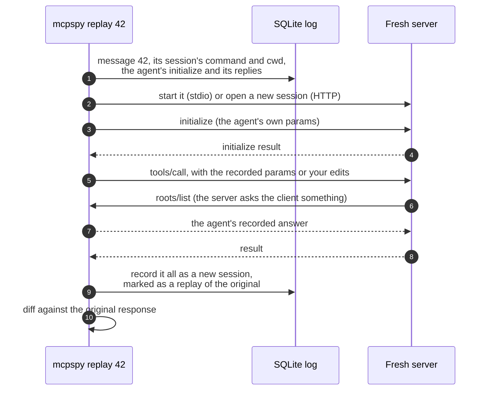
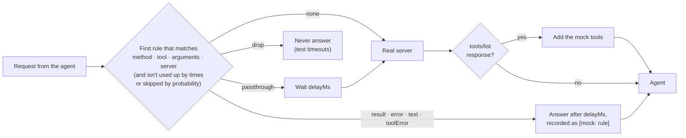
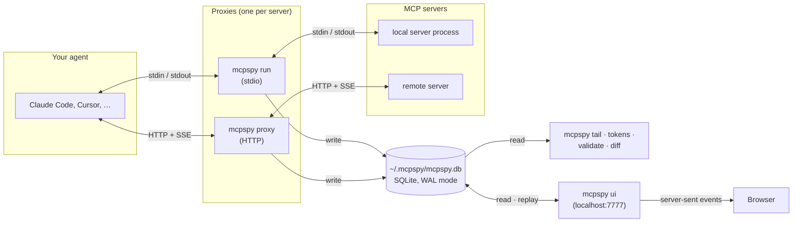
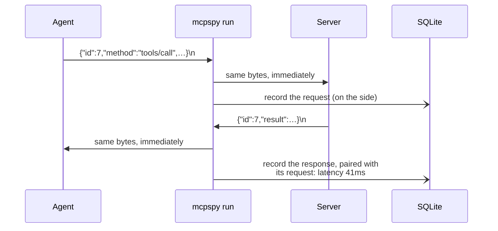
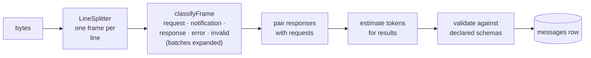
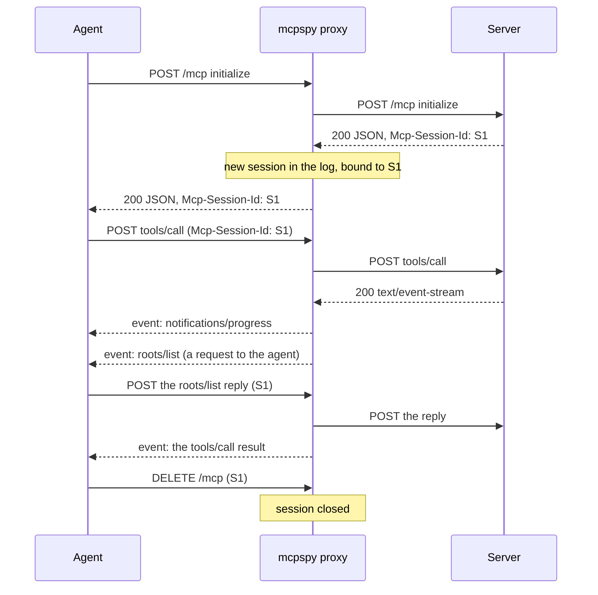

<h1 align="center">🔍 mcpspy</h1>

<p align="center">
    <strong>See, replay and mock what your AI agent says to its MCP servers.</strong><br>
    mcpspy sits between an agent (Claude Code, Cursor, Windsurf, …) and a <a href="https://modelcontextprotocol.io">Model Context Protocol</a> server<br>
    and records every message: what was called, with what, how long it took, what failed and how much context it cost.
</p>

<p align="center">
    <a href="https://github.com/Jarryd-W-Hoffman/mcp-spy/actions/workflows/tests.yml"></a>
    
    
    
</p>

<p align="center">
    
</p>

<p align="center">
    <a href="#why-mcpspy">Why mcpspy?</a> ·
    <a href="#quick-start">Quick start</a> ·
    <a href="#guide">Guide</a> ·
    <a href="#how-it-works">How it works</a> ·
    <a href="#your-log-on-disk">Your log on disk</a> ·
    <a href="#how-its-built">How it's built</a> ·
    <a href="#known-limitations">Known limitations</a> ·
    <a href="#development">Development</a>
</p>

---

## Why mcpspy?

MCP traffic is invisible. The agent says "the tool failed", or quietly picks the wrong tool, and all you have to go on is the model's summary of what happened. mcpspy shows you the messages themselves.

- **See what really happened.** Every request, response, notification and stderr line, paired up, timed and searchable, live in a web UI or your terminal. Unlike the official [MCP Inspector](https://github.com/modelcontextprotocol/inspector), which is a client *you* drive, mcpspy records what your *real agent* sends.
- **Know what it costs.** Every tool definition a server advertises is sent to the model on every turn. mcpspy shows how many tokens each tool and each result adds, and what changed since the server's last session.
- **Reproduce without re-prompting.** Replay any recorded call against a fresh server, edit its arguments, run it 20 times for a latency spread, or save it in a regression suite that runs in CI.
- **Catch protocol bugs early.** Arguments and results are checked against the schemas the server itself declared, as they pass through.
- **Fake what isn't there.** Answer calls from mock rules (outages, rate limits, slow responses, bad payloads) to see how an agent copes, or stand in for a server that doesn't exist yet.
- **Nothing leaves your machine.** The log is a SQLite file in your home folder. The UI and proxy only listen on localhost, environment variable values are never stored, and HTTP headers such as `Authorization` are never recorded.

## Quick start

> [!NOTE]
> mcpspy isn't on npm yet. Install it from source; it needs **Node 22.13 or later** (for the built-in `node:sqlite`).

```sh
git clone https://github.com/Jarryd-W-Hoffman/mcp-spy.git
cd mcp-spy
npm install
npm run build
npm link        # puts `mcpspy` on your PATH
```

**Stdio servers** (ones your agent starts as a process): run `mcpspy wrap` next to your `.mcp.json`, and restart the agent.

```sh
mcpspy wrap              # puts mcpspy in front of every stdio server in .mcp.json
mcpspy wrap --dry-run    # shows what it would change, without changing it
mcpspy unwrap            # puts the config back as it was
```

It works on any JSON config that lists `mcpServers` or `servers`: pass the path for Cursor (`.cursor/mcp.json`), VS Code (`.vscode/mcp.json`), Claude Desktop (`claude_desktop_config.json`) or Windsurf. Use `--only <name>` to wrap one server. Use `--command <path>` when the agent can't find `mcpspy` on its PATH, which is common for desktop apps. The file is rewritten with its own indentation, so entries written on one line come back spread over several.

<details>
<summary>What <code>wrap</code> changes, if you'd rather edit by hand</summary>

Each server's command moves behind `mcpspy run --`:

```json
{
  "mcpServers": {
    "github": {
      "command": "mcpspy",
      "args": ["run", "--name", "github", "--", "npx", "-y", "@modelcontextprotocol/server-github"]
    }
  }
}
```

</details>

**A server over HTTP** (remote, or local on a port): start a proxy, and give the agent the local URL it prints.

```sh
mcpspy proxy https://mcp.example.com/mcp --name example
# Point your agent at http://127.0.0.1:7800/mcp

claude mcp add --transport http example http://127.0.0.1:7800/mcp
```

**Then watch** while you use the agent as usual:

```sh
mcpspy ui --open      # the web inspector, at http://localhost:7777
mcpspy tail -f        # or follow along in the terminal
```

## Guide

### 👀 Watching traffic

Every session shows up live. Each row pairs a request with its response, with status, latency, size and token cost. Click a row to see both as a JSON tree or raw text, with tool results rendered the way the agent received them (text and images). Filter by server, text, notifications, stderr, errors or schema issues, and move between rows with <kbd>↑</kbd> / <kbd>↓</kbd>.

The terminal gets the same stream:

```
$ mcpspy tail -f
20:52:08.496 everything #1 → initialize id=0 150B
20:52:08.689 everything #2 stderr Starting default (STDIO) server...
20:52:08.716 everything #3 ← initialize ✓ 220ms id=0 3.4KB
20:52:08.729 everything #5 → tools/list id=1 46B
20:52:08.736 everything #6 ← tools/list ✓ 8ms ≈2.2k tok id=1 9.9KB
20:52:08.761 everything #7 → tools/call echo id=2 108B
20:52:08.765 everything #8 ← tools/call echo ✓ 4ms ≈6 tok id=2 89B
```

The server's stderr is recorded alongside its messages, which often explains failures that look silent from the agent. So is anything a server prints to stdout that isn't JSON-RPC (a classic way to break a stdio server): it's forwarded as-is and logged as `invalid`.

### 🌐 Servers over HTTP

`mcpspy proxy <url>` handles both HTTP transports: **Streamable HTTP**, and the older **HTTP+SSE**. Requests go to the same path on the real server, with their headers. Each MCP session is recorded as its own session, including the JSON-RPC in POST bodies, JSON responses, and every event on SSE streams: progress notifications, and requests the server makes mid-call, such as `roots/list`. HTTP errors, such as a 401, are logged with the session. A session ends when the client sends `DELETE` or closes the stream. `--mocks` works here too.

<p align="center">
    
</p>

Headers such as `Authorization` are forwarded but never recorded. Replays and suites against servers that need them take the headers on the command line: `mcpspy replay 42 -H "Authorization: Bearer $TOKEN"`.

### 🪙 Context cost

Every tool definition a server advertises is sent to the model with every request, and every tool result lands in the conversation. mcpspy estimates both:

- The **Tokens** column shows what each result adds to the context.
- The **Tools** tab breaks a session's tool definitions down per tool. It shows what changed since that server's previous session (tools added or removed, and edited descriptions and schemas, with the token change), plus per-tool call counts, errors, latency and result sizes.

<p align="center">
    
</p>

```sh
mcpspy tokens                 # the same report in the terminal, for the latest session
mcpspy tokens --exact         # exact counts from Anthropic's count_tokens API
```

The estimates are an offline heuristic (see [Token estimates](#token-estimates)), so treat them as relative sizes. `--exact` asks the [count_tokens](https://platform.claude.com/docs/en/build-with-claude/token-counting) endpoint instead (default model `claude-opus-5-5`, change it with `--model`). It needs `ANTHROPIC_API_KEY` or an `ant auth login` profile, and **sends the recorded tool definitions and results to Anthropic**, so it only runs when you ask. Counts are cached in the log per model.

### ⚖️ Comparing calls

In the UI, click **Compare…** on one row, then select another. The detail pane shows the changed paths and a line diff of both requests and both responses. Lists of tools, prompts and resources are matched by `name` or `uri`, so an added or removed entry reads as exactly that, not as every later item shifting by one.

```sh
mcpspy diff 12 40             # two requests: diffs their arguments and their responses
```

### 🔁 Replay

Re-run any request the agent made, against a fresh copy of the server, without prompting the agent again.



Because the replay sends the agent's own `initialize` and answers the server's questions with the agent's recorded replies, the server sees the same client it saw the first time. Each replay is its own session, tagged *replay of #N*, so it can be inspected and diffed like any other traffic.

In the UI, select a request and click **Replay…** to edit its params and run it. The replayed call opens diffed against the original.

<p align="center">
    
</p>

```sh
mcpspy replay 42                                # same params; diffs the response against the original
mcpspy replay 42 --args '{"query":"rust"}'      # new arguments for a tools/call
mcpspy replay 42 --repeat 20                    # latency spread over 20 runs in one server session
mcpspy replay 42 -e GITHUB_TOKEN=$GITHUB_TOKEN  # extra environment for a stdio server
mcpspy replay 42 -H "Authorization: Bearer $T"  # headers for a server over HTTP
```

mcpspy records the *names* of the environment variables each stdio server started with, never their values. If the original server had config-like variables (API keys, tokens, URLs) that aren't set when you replay, mcpspy names them, so you can pass them with `-e` or start `mcpspy ui` with them exported.

### 🧪 Replay suites

Save recorded calls to a JSON file in your server's repository, then check that the server still answers the same way, without an agent:

```sh
mcpspy suite add mcp.suite.json 42 57 63   # cases from recorded requests
mcpspy suite run mcp.suite.json            # exits 1 if any response changed
mcpspy suite run mcp.suite.json --update   # accept the new responses
```

```
✓ tools/call echo 6ms
✗ tools/call search_docs 41ms
    content[0].text  "3 results" → "0 results"
✓ tools/call get-sum 1ms

2 passed, 1 failed
```

A suite is plain JSON, meant to be reviewed and committed:

```json
{
  "version": 1,
  "servers": {
    "docs": {
      "command": ["node", "dist/index.js"],
      "cwd": ".",
      "initialize": { "protocolVersion": "2025-06-18", "capabilities": { "roots": {} }, "clientInfo": { "name": "claude-code", "version": "2.1.0" } },
      "clientReplies": { "roots/list": { "result": { "roots": [{ "uri": "file:///work/docs" }] } } }
    }
  },
  "cases": [
    {
      "name": "tools/call search_docs",
      "server": "docs",
      "method": "tools/call",
      "params": { "name": "search_docs", "arguments": { "query": "install" } },
      "expect": { "content": [{ "type": "text", "text": "3 results" }] },
      "ignore": ["structuredContent.took_ms"]
    }
  ]
}
```

Servers reached over HTTP are stored as `"url"` and `"transport"` instead of a command (never with headers; pass those to `suite run` with `-H`). A working directory below the suite file is stored relative to it, with forward slashes, so the suite runs on any OS. For values that change between runs, list their paths in a case's `ignore`: `*` matches one key and `[*]` any array index, e.g. `["structuredContent.now", "content[*].text"]`. Run it in CI like any other test command.

### ✅ Schema validation

Every message is checked as it is recorded, against what the server itself declared:

- **Calls:** `tools/call` arguments against the tool's `inputSchema` (JSON Schema draft-07 or 2020-12, with formats such as `uri` and `date-time`), and calls to tools the server never listed.
- **Results:** content blocks against the MCP rules (block types and their required fields, `isError`) and, when the tool has an `outputSchema`, `structuredContent` against it.
- **Tool lists:** duplicate names, names outside `A–Z a–z 0–9 _ - .`, and missing or invalid schemas.

Issues show up as `⚠ 2 issues` in `tail`, as a badge and a list in the UI (with a *Schema issues* filter), and in `mcpspy validate`, which exits 1 on errors:

```
$ mcpspy validate
everything #1  tools/call get-sum request #19
  error    params.arguments  missing required property "b"
  error    params.arguments.a  must be number

2 errors, 0 warnings in 1 message
```

<p align="center">
    
</p>

### 🎭 Mocks

A mock file holds rules that answer requests instead of the server, and tools to add to its tool list:

```json
{
  "tools": [
    { "name": "forecast", "inputSchema": { "type": "object", "properties": { "city": { "type": "string" } }, "required": ["city"] } }
  ],
  "rules": [
    { "name": "outage", "match": { "tool": "forecast", "arguments": { "city": "Oslo" } }, "toolError": "Service unavailable" },
    { "name": "flaky search", "match": { "tool": "search*" }, "error": { "code": -32000, "message": "rate limited" }, "probability": 0.3 },
    { "name": "slow fetch", "match": { "tool": "fetch" }, "passthrough": true, "delayMs": 4000 },
    { "name": "hang", "match": { "method": "resources/read", "params": { "uri": "file:///big.log" } }, "drop": true },
    { "name": "forecast", "match": { "tool": "forecast" }, "text": "Sunny in {{arguments.city}}", "delayMs": 300 }
  ]
}
```

Each request from the agent goes through the rules in order:



- **match** on `method`, `tool` (with `*` wildcards; implies `tools/call`), `arguments` or `params` (the request must contain these values), and `server` (the `--name`). The first matching rule wins.
- **Answer** with exactly one of `result`, `error`, `text` (a one-block tool result), `toolError` (the same, with `isError: true`), `passthrough` (forward to the real server after `delayMs`) or `drop`. Strings can use `{{arguments.city}}` or `{{params.uri}}`.
- **Limit** a rule with `times` (stop after N uses) or `probability` (0–1, for flaky behaviour), and slow it down with `delayMs`.

Use it in front of a real server with `mcpspy run --mocks mocks.json -- <cmd>` (or `mcpspy proxy --mocks`). Without a real server, `mcpspy mock serve mocks.json` is a stand-in that also answers `initialize`, `ping` and `tools/list` from the file. The file reloads when you save it; if the new version is broken, the old rules stay and a warning goes to stderr. `mcpspy mock add mocks.json <id>...` appends rules that reproduce recorded calls, copying each tool's definition from the session's tool list.

Mocked responses are recorded like real ones, and labelled with the rule that produced them. Mock tools are validated like real ones too, so a mock that breaks its own `outputSchema` gets flagged.

<p align="center">
    
</p>

### Command reference

| Command | What it does |
| --- | --- |
| `mcpspy wrap [<config>] [--only <name>] [--dry-run] [--command <path>]` | Put mcpspy in front of the stdio servers in an MCP config (`.mcp.json` by default). |
| `mcpspy unwrap [<config>] [--only <name>] [--dry-run]` | Take it out again, restoring each server's command and args. |
| `mcpspy run [--name <label>] [--mocks <file>] -- <cmd> [args…]` | Start a stdio server behind the proxy. `mcpspy -- <cmd>` is shorthand. |
| `mcpspy proxy <url> [--port 7800] [--name <label>] [--mocks <file>]` | Proxy a server reached over HTTP (Streamable HTTP or HTTP+SSE). |
| `mcpspy ui [--port 7777] [--open] [--read-only]` | Serve the web inspector on localhost. `--read-only` turns replay off. |
| `mcpspy tail [-f] [-n 50] [--session <id>] [--json]` | Print recorded messages; `-f` follows new ones, `--json` prints NDJSON rows. |
| `mcpspy sessions [--limit 20]` | List recorded sessions with their status and message count. |
| `mcpspy show <message-id>` | Pretty-print a message alongside its request or response. |
| `mcpspy tokens [--session <id>] [--exact] [--model <id>]` | Context cost of a session's tools, call stats, and tool list changes. |
| `mcpspy diff <id> <id>` | Diff two messages, or two requests and their responses. |
| `mcpspy replay <id> [--args <json> \| --params <json>] [--repeat <n>] [-e K=V] [-H 'Name: value']` | Re-run a recorded request against a fresh server (or session) and diff the response. |
| `mcpspy suite add <file> <id>...` / `mcpspy suite run <file> [--update] [-H …]` | Save recorded calls as a regression suite, and run it. |
| `mcpspy validate [--session <id>]` | List schema and protocol issues; exits 1 if there are errors. |
| `mcpspy mock serve <file>` / `mcpspy mock add <file> <id>...` | Run a stand-in server from mock rules; turn recorded calls into rules. |

Every command takes `--db <path>`. The default log is `~/.mcpspy/mcpspy.db`, or `$MCPSPY_DB` if it's set.

## How it works

mcpspy is three kinds of process that never talk to each other directly. They meet in one SQLite file:



Your agent starts one `mcpspy run` per stdio server, so a busy setup has several proxies writing at once, plus a UI and a `tail` reading. SQLite in WAL mode lets readers and writers work side by side, and a busy timeout covers the moments two writers collide. No proxy has to know whether a UI is running.

### The stdio proxy: forward first, record second

The proxy's first job is to stay out of the way. Bytes are forwarded the moment they arrive, unchanged; a copy goes to a line splitter that records complete messages on the side:

```ts
// src/proxy/stdio.ts (simplified)
const onInput = (chunk: Buffer): void => {
  child.stdin.write(chunk);   // the agent's bytes reach the server untouched…
  fromClient.push(chunk);     // …and a copy is framed and recorded
};
child.stdout.on('data', (chunk: Buffer) => {
  output.write(chunk);        // the server's reply goes straight back
  fromServer.push(chunk);
});
```



Recording is wrapped so it can never take the session down: if the database fails, the proxy warns once on stderr and keeps forwarding. Signals are passed on to the server, and the proxy exits with the server's exit code, so the agent sees exactly what it would without mcpspy.

With `--mocks`, the proxy has to read a request before deciding whether the server sees it at all, so it forwards whole lines instead of raw chunks. Mock rules are the only reason it ever does.

### From bytes to a recorded message



Requests flow both ways in MCP: servers ask the client for roots, sampling and elicitation. So pending requests are keyed by **who sent them** as well as their JSON-RPC id. Otherwise a server's request `id: 0` would collide with the agent's own `id: 0`:

```ts
// src/recorder.ts
if (message.kind === 'response' || message.kind === 'error') {
  const requester = direction === 'server' ? 'client' : 'server';
  const request = this.pending.get(`${requester}:${message.rpcId}`);
  // → request_id, latency_ms, and the method the response answers
}
```

Validation works the same way, one session at a time: the session's latest `tools/list` response is compiled into JSON Schema validators (with [Ajv](https://ajv.js.org)), and each later call and result is checked against them as it passes.

### The HTTP proxy

Over HTTP, one MCP session is spread across many HTTP requests. A POST can be answered with plain JSON, or with an SSE stream that carries progress notifications and even requests *to* the client before the final result. mcpspy has to follow all of it and put it back together as one session.



Each request is matched to a session like this:

| The request has… | Recorded in |
| --- | --- |
| an `Mcp-Session-Id` header mcpspy has seen | that session |
| an `Mcp-Session-Id` mcpspy hasn't seen | a new session (it started before the proxy did) |
| no header, and it's an `initialize` | a new session, bound to the id in the server's reply |
| no header, on a legacy `/messages?sessionId=…` endpoint | the session whose event stream named that endpoint |
| none of these | the latest session, for servers that never assign ids |

The legacy HTTP+SSE transport works differently. The client opens an event stream with a GET, and the server's first event names the URL to POST messages to. When that URL is absolute, the proxy rewrites it to point at itself, or the agent's messages would go straight past it.

To make that possible, SSE responses are forwarded **one event at a time** rather than byte by byte. Each event is held until its terminating blank line, recorded, rewritten if it has to be, then sent. An event isn't usable by the client until that blank line anyway, so this adds no delay. JSON responses are buffered and forwarded whole. The proxy asks the server for uncompressed bodies so it can read them; if a server compresses anyway, the bytes pass through untouched and a decompressed copy is recorded.

### The live UI

`mcpspy ui` is a small `node:http` server plus a React app. Because the proxies are separate processes, the UI can't be told about new messages; it watches the log instead. One shared poller asks SQLite for rows past the last id it has seen (every 250 ms, an indexed query that costs almost nothing), and pushes them to every open browser tab over server-sent events. A tab that reconnects says which id it saw last and gets what it missed.

### Token estimates

Claude's tokenizer isn't public, so offline estimates use a heuristic that's close enough to compare sizes:

```ts
// src/tokens.ts
return Math.ceil(ascii / 3.5 + other);   // ~3.5 ASCII characters per token, 1 per other character
```

Images are costed by their pixel dimensions (read from the PNG, GIF, JPEG or WebP header), the way Claude scales them. `--exact` measures instead of estimating. It counts a request with every tool, then with each tool left out; the difference is that tool's cost, and what's left over is the fixed tool-use preamble.

### Security model

Recorded traffic often holds secrets: tokens in tool arguments, private documents in results. So:

- **Only localhost.** The UI and the HTTP proxy bind to `127.0.0.1` and refuse requests whose `Host` isn't a loopback name, which stops DNS-rebinding attacks from a web page. The proxy also refuses a non-local `Origin`.
- **Replay can't be triggered cross-site.** Replay starts processes, so its endpoint also requires a custom header and a JSON body. A cross-site request can't send those without a CORS preflight, and mcpspy never approves one. It also checks `Origin` and `Sec-Fetch-Site`. `mcpspy ui --read-only` turns replay off entirely.
- **Names, not values.** For stdio servers, mcpspy stores the names of environment variables (so replay can say which are missing), never their values. Over HTTP, headers are never stored at all.
- **Opt-in network calls.** Nothing is sent anywhere unless you run `mcpspy tokens --exact`, which says so in its help.

## Your log on disk

Everything lives in one SQLite file, `~/.mcpspy/mcpspy.db` (or `--db` / `$MCPSPY_DB`):

| Table | One row per |
| --- | --- |
| `sessions` | server session: name, transport (`stdio`, `http`, `sse`, `mock`, `replay`), command or URL, working directory, start and end, exit code, and the session it replays |
| `messages` | message: direction, kind, method, JSON-RPC id, the raw payload, the request it answers, latency, tokens, schema issues, and the mock rule that answered it |
| `exact_counts` | cached `count_tokens` result per message and model |

It's yours to query. For example, the slowest tools across every session:

```sql
SELECT json_extract(req.payload, '$.params.name') AS tool,
       count(*)                                    AS calls,
       round(avg(res.latency_ms))                  AS avg_ms,
       sum(res.tokens)                             AS tokens
FROM messages res
JOIN messages req ON req.id = res.request_id
WHERE res.method = 'tools/call'
GROUP BY tool
ORDER BY avg_ms DESC;
```

```
tool                            calls  avg_ms  tokens
------------------------------  -----  ------  ------
trigger-long-running-operation  1      2019    19
get-forecast                    2      93      11
echo                            3      20      26
get-sum                         3      10      64
```

For a pipeline instead, `mcpspy tail --json` prints the same rows as NDJSON. Delete the file to start over.

## How it's built

| Part | Technology |
| --- | --- |
| CLI and proxies | TypeScript on Node.js, with only `node:` built-ins for processes, HTTP and streams |
| Log | [`node:sqlite`](https://nodejs.org/api/sqlite.html) (SQLite built into Node), in WAL mode |
| Validation | [Ajv](https://ajv.js.org) with [ajv-formats](https://github.com/ajv-validator/ajv-formats), for draft-07 and 2020-12 schemas |
| Web UI | [React 19](https://react.dev) and [Vite 8](https://vite.dev), bundled into `dist/ui` and served by the CLI |
| Exact token counts | [Anthropic TypeScript SDK](https://github.com/anthropics/anthropic-sdk-typescript), loaded only for `--exact` |
| Tests | [Vitest](https://vitest.dev), against real child processes and real HTTP servers |

```text
src/
├── cli.ts              ← every command
├── proxy/
│   ├── stdio.ts        ← mcpspy run
│   ├── http.ts         ← mcpspy proxy (Streamable HTTP and HTTP+SSE)
│   └── mock-server.ts  ← mcpspy mock serve
├── framing.ts · sse.ts · jsonrpc.ts   ← bytes → frames → classified messages
├── recorder.ts         ← pairs, costs and validates each message, then stores it
├── store.ts            ← the SQLite log
├── tokens.ts · exact.ts · report.ts   ← context cost
├── validate.ts         ← schema checks
├── mocks.ts            ← mock rules
├── rpc-client.ts · http-client.ts     ← the minimal clients replay and suites use
├── replay.ts · suite.ts · diff.ts
└── server.ts           ← the UI's API and live stream
ui/src/                 ← the React app
```

### Why this stack?

**TypeScript on Node,** because that's where MCP lives. Most servers are started with `npx`, the official SDKs are TypeScript-first, and anyone running an MCP server already has Node installed. A Go or Rust binary would start faster and ship as one file, but it would ask people to install a new runtime for a debugging tool.

**`node:sqlite` rather than a SQLite package,** because the popular ones (such as `better-sqlite3`) are native modules, compiled for each platform and Node version, and they're the classic thing that breaks `npm install`. The built-in module needs nothing compiled. The cost is the Node 22.13 minimum, and an API that's younger than the packages it replaces.

**No web framework.** The UI's API is a handful of routes, and `node:http` covers them; the HTTP proxy needs raw access to streams and headers that frameworks tend to hide. The React app is bundled at build time, so the CLI has just three runtime dependencies, and one of those only loads for `--exact`.

**Polling SQLite instead of messaging between processes.** Proxies, the UI and `tail` are separate processes started at different times by different parents. A shared database with an indexed "rows after id N" query is simpler and sturdier than sockets between them, and a quarter of a second of delay is invisible when you're watching an agent work.

**Raw JSON-RPC instead of the MCP SDK for replays.** The SDK would rebuild requests its own way, and validate them. A replay has to send exactly what was recorded, or exactly your edit, even when that's invalid, because sometimes the invalid request is the bug you're chasing.

## Known limitations

- **Not on npm yet.** Install from source for now.
- **Replays from the UI can't send headers.** HTTP servers that need `Authorization` fail there with a 401 and a hint; use `mcpspy replay -H` instead.
- **Mock rules apply to single requests.** Batched requests always go to the real server.
- **Token estimates are estimates.** Use them to compare sizes, or `--exact` for real numbers.
- **One log per machine by default.** Sessions from every project share `~/.mcpspy/mcpspy.db`; use `--db` or `MCPSPY_DB` to keep a project's traffic apart.

## Development

```sh
npm test              # Vitest
npm run typecheck     # the CLI and the UI
npm run build         # dist/ (CLI) and dist/ui (web UI)
npm run dev -- tail   # run the CLI from source via tsx

# The UI with hot reload: the API on :7777, Vite on :5173 proxying /api to it
npm run dev -- ui
npm run dev:ui
```

The tests run against real processes and sockets rather than mocks of them. A stdio fixture server (`test/fixtures/echo-server.mjs`) can echo, stall, ask the client for roots, and print junk to stdout on purpose. An HTTP fixture (`test/fixtures/http-server.ts`) speaks both Streamable HTTP and legacy SSE, including a mid-call request to the client.

[GitHub Actions](.github/workflows/tests.yml) runs on every push and pull request:

- **Types, tests and the build** on Node **22.13.0** (the oldest version mcpspy supports, so the `engines` promise is checked) and Node **24**.
- A **smoke test** of the built CLI: proxy a real stdio server, then read the result back with `tail`.
- **`npm audit`** for known vulnerabilities in dependencies.

Dependabot proposes grouped weekly updates for npm packages and GitHub Actions.

### Contributing

Pull requests are welcome.
- Work on a feature branch and keep commits small.
- Each change comes with tests, and `npm test` and `npm run typecheck` should pass before you open a PR.
- If you change what's recorded, check an old log still opens: columns are added by migrations in `src/store.ts`, and older sessions are backfilled when a log is opened.

## License

mcpspy is open-source software licensed under the [MIT license](LICENSE).
